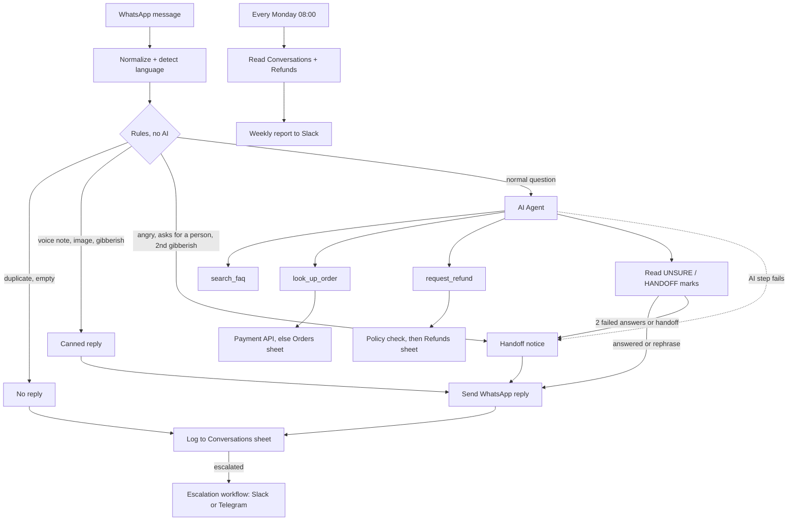

# WhatsApp AI Support Agent (n8n 2.x)

**Demo on made-up data. Not yet run against a live WhatsApp number.**

"Cedar Course Co." is an invented online store that sells one digital course with a one-time payment. Customers write in English and Arabic. This demo shows how I would build the support line for a shop like that.

## What it does
1. A WhatsApp message arrives; code cleans it, finds the language (English or Arabic) and applies safety rules before any AI is used.
2. Normal questions go to an AI Agent with three tools: **search_faq**, **look_up_order** (payment API, then an Orders sheet as fallback) and **request_refund**.
3. The agent cannot approve money. A separate workflow checks the order owner, the 14-day window and a 150 USD limit, and logs a row with status `pending approval`.
4. Angry customers, "I want a person", two failed answers, refunds over the limit and AI errors are handed to a person in Slack (or Telegram) with the last messages, and the customer is told a person will reply.
5. A weekly report counts messages, topics, resolved, handed over, and refunds.



## Files
| Path | What |
|---|---|
| `workflows/support-agent.json` | Main flow: trigger, rules, AI Agent, reply, log |
| `workflows/escalation.json` | Sub-workflow: handoff message to Slack (Telegram option) |
| `workflows/order-lookup.json` | Sub-workflow used as a tool: payment API, then Orders sheet |
| `workflows/refund-request.json` | Sub-workflow used as a tool: policy check, then Refunds sheet |
| `workflows/weekly-report.json` | Monday report from the two sheets |
| `workflows/error-handler.json` | Catch-all error workflow (alerts on Telegram) |
| `kb/faq.md` | The FAQ, English and Arabic (11 entries) |
| `sheets/*.csv` | Sheet templates: `Orders` (made-up rows), `Refunds`, `Conversations` |
| `samples/*.json` | 24 made-up WhatsApp webhook payloads + `expected.json` |
| `code/*.js` | The Code node sources; `node tools/build.mjs` builds the JSON from them |
| `test/run-tests.mjs`, `results.md` | The test runner and its latest output |

## Import and connect
1. Create one Google spreadsheet with three tabs named `Orders`, `Refunds`, `Conversations`. Import the matching CSV into each (header row first).
2. In n8n: Workflows, Import from File. Import in this order: `error-handler`, `escalation`, `order-lookup`, `refund-request`, `support-agent`, `weekly-report`.
3. Replace the placeholders: `REPLACE_ME_SPREADSHEET_ID` (Sheets nodes), `REPLACE_ME_CHANNEL_ID` (Slack), `REPLACE_ME_CHAT_ID` (Telegram), `REPLACE_ME_PHONE_NUMBER_ID` (WhatsApp send node), and the three workflow ids: `REPLACE_ME_ORDER_LOOKUP_WORKFLOW_ID` (in `support-agent` and `refund-request`), `REPLACE_ME_REFUND_REQUEST_WORKFLOW_ID` and `REPLACE_ME_ESCALATION_WORKFLOW_ID` (in `support-agent`). Then open each node that calls a workflow once and press the refresh icon beside its inputs, so n8n reads the sub-workflow's input names.
4. Set the credentials (all ship as placeholders with id `REPLACE_ME`):

| Credential | Used by |
|---|---|
| WhatsApp Business Cloud (`whatsAppApi`) and WhatsApp trigger (`whatsAppTriggerApi`) | `support-agent` |
| OpenAI (`openAiApi`); any n8n chat model node can replace it | `support-agent` |
| Google Sheets OAuth2 | `support-agent`, `order-lookup`, `refund-request`, `weekly-report` |
| Slack (`slackApi`) | `escalation`, `weekly-report` |
| Telegram bot | `error-handler`, optional in `escalation` |
| Header auth for the payment API | `order-lookup` (placeholder URL `api.payments.example.com`) |

5. In each workflow's Settings, set **Error Workflow** to `Error Handler`. This is a UI-only setting; an import cannot set it.
6. Activate `support-agent` last. Static data (duplicate ids, failed-answer counters, short chat history) only persists while a workflow is active, not in manual test runs.

### Sheets and columns
- `Orders`: order_id, customer_phone, customer_name, product, amount, currency, purchased_at, status
- `Refunds`: requested_at, message_id, customer_phone, customer_name, order_id, product, amount, currency, reason, language, status, handled_by, handled_at
- `Conversations`: logged_at, message_id, customer, language, message_type, topic, route, outcome, escalation_reason, order_id, delivery

`Conversations` keeps only the last 4 digits of a phone number. `Refunds` and the Slack message keep the full number, because a person must reply.

### Slack to Telegram
Open `escalation`: disable `Post to Slack`, enable `Post to Telegram (optional)`, pick the bot credential and set the chat id. Same swap for the report in `weekly-report` (email option: `Email Report (optional)`).

## The rules, in order
| # | Rule | Result |
|---|---|---|
| 1 | Message id already seen | ignored |
| 2 | Not text (voice note, image, ...) | canned reply asking for text |
| 3 | Empty text | ignored |
| 4 | Anger score 2 or more (strong word, or mild word + shouting or `!!!`) | handoff |
| 5 | Asks for a person / manager (EN, AR) | handoff |
| 6 | Gibberish (second time in a row) | first: "please rephrase"; second: handoff |
| 7 | Anything else | AI Agent |
| 8 | Agent ends with `[[UNSURE]]` | "not sure, rephrase"; second time in a row: handoff |
| 9 | Agent ends with `[[HANDOFF:reason]]` | handoff |
| 10 | Agent step errors | handoff |

## Tests
```bash
node test/run-tests.mjs
```
No installs, no network. The runner takes the JavaScript straight out of the workflow JSON and runs it on the 24 payloads, then checks FAQ search, order and refund rules, the report counts, workflow structure, node types, connections, secrets and these docs. Latest output: [results.md](results.md) (145 of 145 checks pass).

### Illustrative conversations (not a live run)
These show what the rules and tools are built to produce. The AI wording is an example, not output from a model.

> **Customer:** I want a refund for order CC-1042, it's not what I expected.
> **Agent (illustrative):** I have logged a refund request for order CC-1042 (89 USD). Status: pending approval. A team member confirms within 2 business days.

> **Customer (AR):** أريد استرجاع المبلغ للطلب CC-2003
> **Flow (illustrative):** the order is 349 USD, above the 150 USD limit, so nothing is logged. The agent ends with `[[HANDOFF:refund_over_limit]]`, the customer gets the Arabic handoff notice, and Slack gets the last messages.

## Limits (plain)
- **The AI Agent step was never run.** It needs a model key. Everything around it is tested; the model's wording and its tool choices are not.
- Import-ready, not yet imported: never loaded into a real n8n and not connected to a real WhatsApp number. 6 of 22 node types were checked in the n8n source, the other 16 come from the docs.
- If the Sheets log write fails after 3 tries, the chat still carries on and a person is still told, but that log row is lost without an alert (n8n treats the error as handled).
- Two settings are written from the n8n docs and could not be proven offline: the expression that feeds the agent's memory key, and the inputs passed to the three sub-workflow tools. Check both in the first live test.
- WhatsApp only allows free-text replies within 24 hours of the customer's last message; later replies need an approved template, which this demo does not include.
- Language detection counts Arabic and Latin letters. Arabic typed in Latin letters is not understood; the message goes to the agent as English.
- Anger and "person" rules are word lists. They will miss some messages and flag a few calm ones.
- A refund request is not checked against earlier requests for the same order (a repeat would add a second row).
- The weekly report reads both sheets in full. Fine for a small shop, not for a very large log.
- The payment API is a placeholder URL; the answer shape it expects is described in the `order-lookup` note.

## Rebuild
```bash
node tools/build.mjs          # code/*.js + kb/faq.md  ->  workflows/*.json
node tools/make-samples.mjs   # samples/*.json + expected.json
```
